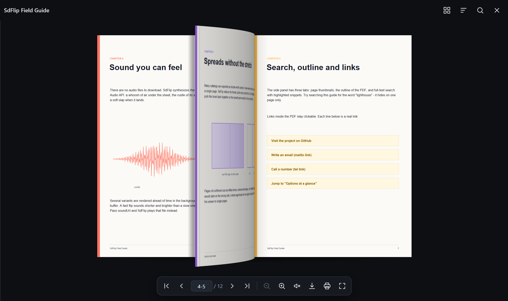

<div align="center">


# SdFlip

**PDFs that turn like paper.**

A free, open-source PDF flipbook for the web: realistic page curl, synthesized paper sounds,<br>
spreads that line up, search and outline, and touch gestures that feel native on any phone.

[**Live demo**](https://pandarens.github.io/SdFlip/) ·
[Documentation](https://pandarens.github.io/SdFlip/#docs) ·
[Releases](https://github.com/Pandarens/SdFlip/releases) ·
[Русский](README.ru.md)


<a href="https://pandarens.github.io/SdFlip/"></a>

</div>

## Features

- **Real page curl.** The sheet bends in an arc with live shading and a cast shadow. Hover a corner and it lifts; grab it and peel.
- **Paper sounds.** A rustle while the page flies and a soft slap when it lands, synthesized with Web Audio. No audio files. Unlocked correctly on iOS.
- **Native on phones.** Swipe, pinch and double tap. One page in portrait, a spread in landscape. An inline viewer never traps page scrolling.
- **Smart spreads.** Double-width spreads (the way InDesign often exports catalogs) are split and reassembled. Other page sizes are fitted with margins, never stretched.
- **Search, outline, thumbnails.** A side panel with page thumbnails, the PDF outline and full-text search with highlighted snippets.
- **Working links.** Web, `mailto:` and `tel:` links inside the PDF stay clickable, internal links jump to their page.
- **Fast and frugal.** The next sheet is prebuilt, rendering pauses while a page flies, and only nearby pages stay in memory, so long catalogs never crash a phone tab.
- **Accessible and localized.** Keyboard shortcuts, screen reader announcements, focus return, reduced motion. English and Russian built in; add any language.
- **Tiny and dependency-free.** 19 KB gzipped plus pdf.js, which is loaded on demand. No jQuery, no framework, no build step.

## Quick start

```html
<link rel="stylesheet" href="https://cdn.jsdelivr.net/gh/Pandarens/SdFlip@1.0.0/dist/sdflip.min.css">
<script src="https://cdn.jsdelivr.net/gh/Pandarens/SdFlip@1.0.0/dist/sdflip.min.js"></script>

<a href="catalog.pdf" data-sdflip data-sdf-title="Spring catalog">View catalog</a>
```

That is the whole integration: every element with `data-sdflip` opens the PDF from its `href` (or the attribute value) in a full-screen flipbook.

### npm

```bash
npm install github:Pandarens/SdFlip
```

```js
import 'sdflip/dist/sdflip.css';
import SdFlip from 'sdflip';

SdFlip.open('/files/catalog.pdf');
```

### Download

Grab `sdflip-1.0.0.zip` from the [releases page](https://github.com/Pandarens/SdFlip/releases) and copy `sdflip.min.js` and `sdflip.min.css` to your site.

## Usage

```js
// Lightbox
const viewer = SdFlip.open({
  source: '/files/catalog.pdf',   // URL, File, Blob, ArrayBuffer or Uint8Array
  title: 'Spring catalog',
  page: 3,
  onFlip: (page) => console.log('now on page', page)
});

// Inline, inside your layout; the height follows the document
SdFlip.inline('#book', { source: '/files/catalog.pdf' });

// Draw a cover thumbnail
SdFlip.cover('/files/catalog.pdf', '#cover', 300);
```

Content added later, for example by a SPA router? Call `SdFlip.scan()` after it is in the DOM.

## Options

Pass them to `SdFlip.open()` / `SdFlip.inline()`, or change `SdFlip.defaults` for every viewer.

| Option | Default | Description |
|---|---|---|
| `source` | `null` | PDF URL, `File`, `Blob`, `ArrayBuffer` or `Uint8Array` |
| `title` | `''` | Caption in the header, also the dialog label |
| `page` | `1` | Page to open first |
| `layout` | `'auto'` | `'double'` always shows spreads, `'single'` always one page |
| `download` | `true` | Download button |
| `downloadUrl` | `null` | File for the download button if it differs from `source` |
| `downloadName` | `null` | File name for the download |
| `print`, `fullscreen` | `true` | Print and fullscreen buttons |
| `thumbs`, `outline`, `search` | `true` | Side panel tabs |
| `sound` | `true` | Page flip sound (the user can toggle it) |
| `soundUrl` | `null` | Your own audio file instead of the synthesized sound |
| `volume` | `0.6` | Sound volume, 0–1 |
| `duration` | `900` | Flip duration, ms. Rapid flips run faster automatically |
| `bend` | `1.45` | Curl strength: 1 is almost flat, 2.2 is strong |
| `perspective` | `5` | Perspective depth in page widths; smaller is more dramatic |
| `depth` | `0.45` | How far the page lifts toward the viewer, 0–1 |
| `stripOverlap` | `2` | Overlap between curl strips, px |
| `queue` | `true` | Queue rapid clicks instead of dropping them |
| `peel` | `true` | Lift the page corner on mouse hover |
| `links` | `true` | Clickable PDF links |
| `fitHeight` | `true` | Inline mode: resize the container to fit the document |
| `maxZoom` | `4` | Maximum zoom |
| `lang` | auto | UI language; detected from `<html lang>`, then the browser |
| `strings` | `null` | Override UI strings, e.g. `{ download: 'Save' }` |
| `pdfjs`, `pdfjsWorker` | cdnjs | URLs of `pdf.min.js` and its worker |
| `cMapUrl` | `null` | pdf.js character maps for some CJK PDFs |
| `onReady(viewer)` | — | First pages are on screen |
| `onFlip(page, direction)` | — | After every turn; direction is `1` or `-1` |
| `onClose(viewer)` | — | Lightbox closed |
| `onError(error, viewer)` | — | The PDF could not be opened |

### Data attributes

`data-sdflip` (source), `data-sdf-title`, `data-sdf-page`, `data-sdf-layout`, `data-sdf-download`, `data-sdf-sound="false"`, `data-sdf-lang`.

### Viewer methods

`next()`, `prev()`, `goTo(page)`, `page()`, `setZoom(factor)`, `toggleSound()`, `toggleFullscreen()`, `download()`, `print()`, `close()`, `destroy()`.

### Keyboard

<kbd>←</kbd> <kbd>→</kbd> flip · <kbd>Home</kbd> <kbd>End</kbd> first and last page · <kbd>+</kbd> <kbd>−</kbd> <kbd>0</kbd> zoom · <kbd>F</kbd> fullscreen · <kbd>S</kbd> sound · <kbd>T</kbd> thumbnails · <kbd>Esc</kbd> close

## Theming

```css
.sdf-root {
  --sdf-bg: #0d0f13;       /* lightbox backdrop */
  --sdf-panel: #171a20;    /* header, toolbar, inline background */
  --sdf-panel2: #212730;   /* hover, inputs */
  --sdf-line: #2e3744;     /* borders */
  --sdf-fg: #e9edf3;       /* text and icons */
  --sdf-muted: #97a1b0;    /* secondary text */
  --sdf-accent: #5b5bf6;   /* active buttons, progress, highlights */
  --sdf-paper: #fff;       /* page color behind the PDF */
}
```

## Localization

```js
SdFlip.locales.de = {
  download: 'PDF herunterladen',
  close: 'Schließen (Esc)',
  pageOf: 'Seite {page} von {total}'
};
```

Missing keys fall back to English. See `SdFlip.locales.en` for every key. Pull requests with new languages are welcome.

## Hosting pdf.js yourself

pdf.js 3.11 loads from cdnjs the first time a PDF opens. To serve it yourself, copy `pdf.min.js` and `pdf.worker.min.js` and set them before or after SdFlip loads:

```html
<script>
  window.SdFlipConfig = { pdfjs: '/vendor/pdf.min.js', pdfjsWorker: '/vendor/pdf.worker.min.js' };
</script>
```

PDFs on another domain need CORS headers. Pages opened straight from disk (`file://`) cannot load PDFs in any browser; serve the folder over HTTP, for example with `npx serve`.

## How it works

1. **pdf.js** parses the PDF in a worker and renders each page to a canvas at the size it is shown.
2. **Virtual pages** turn double-width spreads into left and right pages, fit odd sizes with margins and insert a blank page when a spread would land on the wrong side.
3. **The turning sheet** is sliced into 14–40 vertical strips nested inside each other. Each strip turns a few degrees more than its parent, so the page bends in an arc. It is plain CSS 3D, composited by the GPU.
4. **Shading** follows the angle of every strip, and strips overlap by 2px, so there are no seams.
5. **Sound** is filtered noise shaped into a rustle, a crackle and a landing slap, pre-rendered into a few buffers that play in sync with the animation.

Try the interactive curl model on the [demo site](https://pandarens.github.io/SdFlip/#how).

## Browser support

Current Chrome, Edge, Firefox and Safari on desktop and mobile, including iOS Safari.

## Development

```bash
npm install          # esbuild for the minified build
npm run build        # src/ -> dist/ and docs/lib/
npm start            # serve the repo, then open /docs/
npm test             # Playwright autotest with your installed Chrome or Edge
```

| Path | What |
|---|---|
| `src/` | The library: `sdflip.js` and `sdflip.css` |
| `dist/` | Built files for the CDN and npm |
| `docs/` | The demo and documentation site (GitHub Pages) |
| `docs/samples/` | Sample PDFs, generated by `tools/make-samples.py` |
| `test/` | Autotests: `run.mjs` (desktop, phones, tablet, inline, file://), `seams.mjs` (no gaps in the curl), `perf.mjs` (frame timing) |

Issues and pull requests are welcome.

## License

[MIT](LICENSE) © 2026 Pandaren
