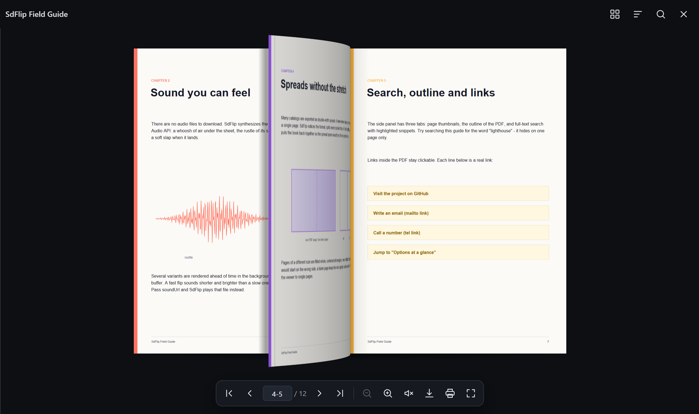

<div align="center">


# SdFlip

**PDF, который листается как бумага.**

Бесплатная листалка PDF для сайтов с открытым кодом: реалистичный изгиб страницы, звук бумаги,<br>
развороты без искажений, поиск и оглавление, жесты на телефоне.

[**Демо**](https://pandarens.github.io/SdFlip/) ·
[Документация](https://pandarens.github.io/SdFlip/#docs) ·
[Релизы](https://github.com/Pandarens/SdFlip/releases) ·
[English](README.md)

<a href="https://pandarens.github.io/SdFlip/"></a>

</div>

## Возможности

- **Настоящий изгиб листа** с тенями; уголок приподнимается при наведении мыши, его можно взять и потянуть.
- **Звук бумаги**: шелест и шлепок синтезируются через Web Audio, без файлов; корректно включается на iPhone.
- **Телефоны**: свайп, щипок, двойное касание; одна страница в портрете, разворот в альбомной ориентации; встроенная листалка не мешает прокручивать страницу.
- **Развороты двойной ширины** (как сохраняет InDesign) делятся на страницы и собираются обратно; страницы другого формата вписываются с полями, без растяжения.
- **Миниатюры, оглавление PDF, поиск по тексту**, кликабельные ссылки (сайт, почта, телефон, переходы внутри файла).
- **Быстро и экономно**: лист собирается заранее, отрисовка ставится на паузу во время анимации, в памяти только соседние страницы.
- **Доступность и языки**: клавиатура, экранный диктор, возврат фокуса; встроены английский и русский интерфейс.
- **19 КБ в gzip**, без jQuery и сборки; pdf.js подгружается сам.

## Подключение

```html
<link rel="stylesheet" href="https://cdn.jsdelivr.net/gh/Pandarens/SdFlip@1.0.0/dist/sdflip.min.css">
<script src="https://cdn.jsdelivr.net/gh/Pandarens/SdFlip@1.0.0/dist/sdflip.min.js"></script>

<a href="catalog.pdf" data-sdflip data-sdf-title="Каталог">Смотреть каталог</a>
```

Любой элемент с `data-sdflip` открывает PDF из `href` в полноэкранной листалке. Язык интерфейса берётся из `<html lang="ru">` или задаётся опцией `lang: 'ru'`.

```js
SdFlip.open({ source: '/files/catalog.pdf', title: 'Каталог', lang: 'ru' });
SdFlip.inline('#book', { source: '/files/catalog.pdf' });   // встроить в страницу
```

Также через npm: `npm install github:Pandarens/SdFlip`, или архив со [страницы релизов](https://github.com/Pandarens/SdFlip/releases).

Все настройки, методы, события, оформление через CSS-переменные и размещение pdf.js на своём сервере описаны в [английском README](README.md#options) и на [сайте документации](https://pandarens.github.io/SdFlip/#docs).

## Лицензия

[MIT](LICENSE) © 2026 Pandaren
